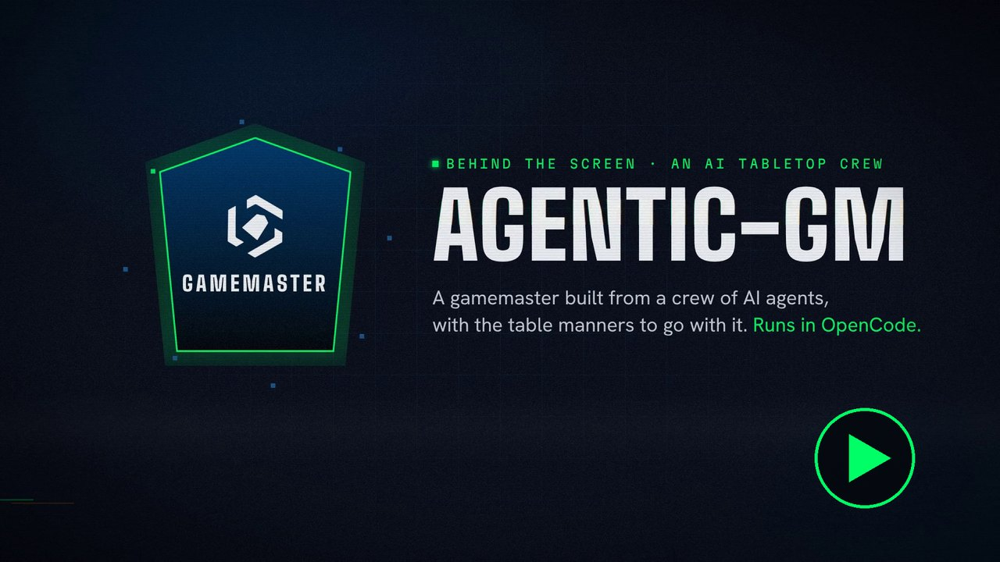

# agentic-gm

A tabletop gamemaster made of a crew of dedicated AI agents: one voice at the table, specialists behind the screen. Built for [OpenCode](https://opencode.ai).

Plain Markdown contracts plus one tiny native dice plugin; no SDK, no service, no external memory.

<p align="center">
  <a href="https://youtu.be/O9caZAXGQmQ"></a>
</p>

<p align="center">
  <a href="https://youtu.be/O9caZAXGQmQ"><b>▶ Watch the presentation (6:42)</b></a> · <a href="https://kakudou.github.io/agentic-gm/">read the field manual</a>
</p>

## Layout

```text
system.md                   global contract: crew, routing, evidence, tabletop flow
agents/*.md                 the eight crew roles (OpenCode agent files)
skills/00-rpg-*             shared, system-agnostic table layer (incl. cross-run progression)
skills/01-shadowrun-*       Shadowrun Sixth World (6E)
skills/02-cyphersystem-*    Cypher System 2025 SRD
plugins/rpg-dice/           OpenCode V2 native dice plugin
sample-opencode.json        minimal OpenCode configuration
agentic-gm.html             field manual (single self-contained page)
agentic-gm-poster.jpg       video poster used at the top of this README
```

## The crew

| Agent file | Role | Writes files? | Calls others? |
| --- | --- | --- | --- |
| `gm-voice` | Sole player-facing GM: framing, dialogue, narration, final reply | no | yes (only one) |
| `intent-keeper` | Player intent, stakes, tone, fairness contract | no | no |
| `scenario-architect` | World and situation architecture, pacing, dispatch plans | no | no |
| `rules-librarian` | Rules & lore retrieval with provenance | no | no |
| `npc-challenger` | NPC motives and reactions, continuity challenge | no | no |
| `scribe` | Dice rolls, arithmetic from faces, Markdown session writes | **yes (only one)** | no |
| `auditor` | Independent PASS / FAIL / UNVERIFIED audit | no | no |
| `chronicler` | Novel-style chronicle of confirmed events | no | no |

Only the GM Voice dispatches; the Scenario Architect returns plans; delegation is one level deep.


## Install

```bash
git clone <this repo> ~/.agentic-gm
ln -s ~/.agentic-gm/system.md ~/.config/opencode/AGENTS.md
ln -s ~/.agentic-gm/agents    ~/.config/opencode/agents
ln -s ~/.agentic-gm/skills    ~/.config/opencode/skills
ln -s ~/.agentic-gm/plugins   ~/.config/opencode/plugins
```

Then, in your OpenCode configuration (see `sample-opencode.json`):

- set `default_agent` to `gm-voice`, so every session enters through the only player-facing agent;
- keep `experimental.subagent_depth` at `1`: the GM Voice spawns, nobody else does.

## Play

Start with `/00-rpg-session start` (or `/01-shadowrun-run` for a Shadowrun job), then just play. Resume with `/00-rpg-resume <session folder>`.

Each session is a folder of Markdown files: `session.md`, `events.md` (append-only truth), `mechanics.md` (dice receipts), `state.md`, `recap.md`, `rules-rulings.md`, `gm-private.md`, `chronicle.md`, `characters/`. An imported character sheet is copied, never edited.

Rolls come from the native `rpg_dice` tool (receipt with every face) or from dice the player reports; nothing else counts as random.

### Your character, across runs

A character's progression lives in a canonical record beside your run folders: `CharacterProgression/<character>/` with `sheet.md`, `inventory.md`, `status.md` and an append-only `progression.md`. Create it with `/00-rpg-progression init`; every new run imports from it. The record changes **only at the end of a run**, in a debrief: what happened, what to keep, what stays in the run. Only the changes you approve are applied, as changes on top of the current record (`+2,000¥`, `+6 Karma`), so runs played in parallel never overwrite each other. Your original sheet is never edited.

## Adding a game

A game is a new numbered skill family (`03-yourgame-*`) that extends the table layer with its real rules and specifics. Model it on `01-shadowrun-*` (rules, lore, run) or `02-cyphersystem-*` (rules, catalog, character, adventure): always a rules skill with the embedded source and quick guides, then only the skills the game needs. Then hook it in:

1. `skills/00-rpg-resolution/SKILL.md` — add your rules skill to the "exactly one local ruleset" list.
2. `skills/00-rpg-session/SKILL.md` — add your game id to the games a session can establish.
3. `system.md` — add your family to the skill-family table and the "one selected rules family" sentence.

## What, why, how: OpenCode only

**What.** agentic-gm is a gamemaster you play with in an OpenCode session. One agent, the GM Voice, talks to you; seven specialists work behind the screen, each in its own context, with its own instructions and its own permissions. Rules, lore, sessions and journals are Markdown skills; the only executable piece is the dice plugin.

**Why OpenCode.** The design leans on things OpenCode provides natively, so they are enforced by the host rather than merely asked for in prose:

- **Per-agent permissions.** Each agent file carries a `permission:` block. Six specialists are denied edit, shell and execute; only the Scribe can write files. The GM Voice is denied writes too, and its `subagent:` allowlist names exactly the seven crew agents, so a generic built-in agent can't become a side door around the crew.
- **A real primary agent.** `default_agent: gm-voice` makes the GM Voice the agent every session starts in. The table's controller is the session's front door, not a convention.
- **Single-level delegation.** `experimental.subagent_depth: 1` matches the contract: the GM Voice spawns, specialists hand back, and plans come back to the GM Voice instead of spawning further agents.
- **In-process native plugins.** `plugins/rpg-dice` registers `rpg_dice` straight into the session's tool list: genuine CSPRNG dice with an audit receipt, no MCP server, no network, no persisted state.
- **Skills as slash commands.** Every skill can be invoked directly (`/00-rpg-session`, `/01-shadowrun-run`, …).

There is deliberately no Claude Code port. Claude Code expresses the same boundaries differently (tool denylists instead of permission blocks, no per-agent subagent allowlist, a host default agent on the main thread), so this package targets one host and does it fully.

**How it runs a turn.**

1. You write what your character does. The GM Voice receives it.
2. Small talk is answered directly. Anything consequential is routed: the Intent Keeper pins down what you're trying and what it costs; the Rules & Lore Librarian brings the exact rule of the active game; the Scribe rolls `rpg_dice` after your pre-roll choices; the NPC Challenger decides what the world perceives and does.
3. The Scribe commits the facts to `events.md` and the receipt to `mechanics.md`, then re-reads both.
4. For big moments the Scenario Architect returns a dispatch plan first, and the Auditor checks the books at checkpoints and at the end of a run.
5. The GM Voice answers with one reply: narration, options with their costs, any rules note in *[brackets]*, and the turn handed back to you.
